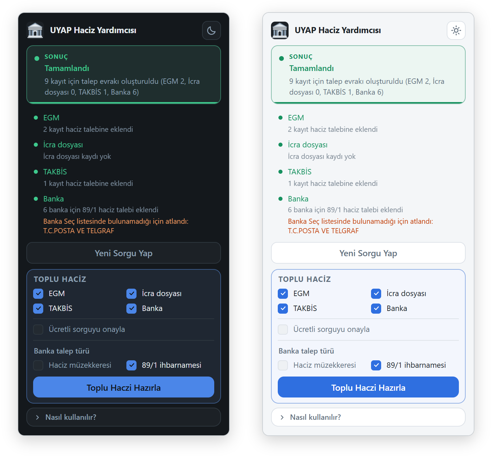

# UYAP Haciz Yardımcısı

### [⬇ Chrome Web Mağazası'ndan ekle](https://chromewebstore.google.com/detail/jhejmhbhkdlamabcdmonlobfeepillpj)

UYAP Avukat Portalı'nda seçili borçlu için EGM, icra dosyası, TAKBİS ve banka hacizlerini tek akışta hazırlayan bir **Chrome eklentisi**.

Avukat Portalı'nda icra takibi yürütenler için yazıldı. Takibin kesinleştiği bir borçlu seçildiğinde çalışır. Seçtiğiniz haciz türlerinin
sorgularını sırayla yapar, çıkan kayıtları haciz talebine ekler ve en sonda tek bir talep evrakı oluşturur. Talebi göndermez. Son kontrol,
imza ve gönderme kullanıcıda kalır.

Eklenti bağımsız bir geliştirici tarafından üretilmiş, yardımcı bir araçtır. UYAP veya Adalet Bakanlığı tarafından geliştirilmiş bir ürün
değildir.

  

## Teşekkür

Bu eklentideki banka haciz ekleme akışı, Raci Çetin Yüksekbaş'ın ([@raciyuksekbas-hub](https://github.com/raciyuksekbas-hub)) fikir önerisi üzerine oluşturulmuştur, kendisine teşekkür ederim.

## Kurulum

Gereken: Bilgisayarda Google Chrome ve UYAP Avukat Portalı'nda açık bir oturum. Eklenti yalnızca https://avukat.uyap.gov.tr sayfalarında
çalışır.

### Chrome Web Mağazası'ndan

1. Yukarıdaki bağlantıya tıklayın, açılan sayfada **Chrome'a ekle**'ye basın.
2. Çıkan küçük pencerede **Uzantı ekle**'ye basın.
3. Adres çubuğunun sağındaki **yapboz parçası** simgesine tıklayıp listede eklentinin yanındaki **raptiye** simgesine basın. Simge araç
   çubuğuna sabitlenir. Eklenti yalnız simgesine basınca çalıştığı için sabitlemek gerekir.

### Kaynak koddan

1. Bu depoyu indirin: Sağ üstteki **Code › Download ZIP**, sonra dosyayı kalıcı bir klasöre çıkarın. Chrome eklentiyi bu klasörden
   çalıştırır, klasör silinirse eklenti durur.
2. Chrome'da adres çubuğuna `chrome://extensions` yazıp Enter'a basın.
3. Sağ üstteki **Geliştirici modu** anahtarını açın.
4. **Paketlenmemiş öğe yükle**'ye basıp içinde `manifest.json` olan klasörü seçin. Windows çıkarırken iç içe iki
   `UYAP-Haciz-Yardimcisi-main` klasörü açtıysa içtekini seçin.

Mağaza sürümü de kuruluysa ikisi aynı UYAP sayfasında birlikte çalışır. Birini `chrome://extensions` sayfasından kapatın.

Kurulumdan sonra yapılacak bir ayar yoktur: Dört haciz türü de seçili, ücretli sorgu onayı kapalı, banka talebi 89/1 olarak başlar.
Eklenti üyelik, e-posta ya da ücret istemez.

## Öne çıkanlar

- **Tek akış:** Seçilen haciz türlerini sırayla sorgular, çıkan kayıtları talebe ekler ve en sonda tek bir talep evrakı oluşturur.
- **Talebi göndermez:** Son kontrol, imza ve gönderme kullanıcıda kalır.
- **Sorgu hakkını korur:** Sonucu ekranda duran sorguyu yinelemez. Ücretli sorgu onayı varsayılan olarak kapalıdır.
- **Banka eşleştirme:** Kesik ya da Türkçe harfsiz yazılmış kurum adlarını Banka Seç listesindeki tek bir bankaya bağlar, her bankayı bir
  kez seçer.
- **Sessizce atlamaz:** Hangi bölümün kaç kayıt eklediği, neyin neden eklenmediği canlı bir listede yazılır.
- **Veri göndermez:** Ağ isteği, analitik ve telemetri yoktur.

## Ne yapar

### Toplu haczi hazırlama

1. UYAP Avukat Portalı'nda bir icra dosyası açın.
2. **Borçlu Bilgileri** sekmesinden takibi kesinleşmiş bir borçlu seçin.
3. Araç çubuğundaki eklenti simgesine tıklayın ve istediğiniz haciz türlerini seçin.
4. **Toplu Haczi Hazırla**'ya basın.

İşlem sürerken sayfada bir yere tıklamayın, sıralamayı sekteye uğratabilirsiniz. Banka bölümü bittiğinde hazırlanan talebi sorgu sonucuyla
karşılaştırın.

En sonda eklenti **Talep Evrakı Oluştur** düğmesine basar. Evrak indirilir ve akış orada durur.

### EGM, icra dosyası ve TAKBİS

- EGM-TNB, İcra Dosyası ve TAKBİS kartlarını sırayla açıp sorgular. Sonuç tablosundaki her satırı **Haciz Talebine Ekle** ile talebe ekler.
- EGM'de her araç için açılan **Haciz Şerhi** penceresinde **Haciz** seçeneğini işaretler.
- Sorgu zaten yapılmış ve sonucu ekrandaysa sorguyu yinelemez, boş yere sorgu hakkı harcamaz.

### Banka haczi

Banka sorgusundan çıkan kurum adlarını **Banka Seç** listesindeki unvanlara bağlar. Eşleştirdiği bankaları **Talep Gönder** sekmesinde tek
tek seçer, tüm hesap türlerini işaretler, seçime göre **89/1 Haciz İhbarnamesi**'ni ya da **Haciz Müzekkeresi**'ni işaretleyip
**Talep Ekle**'ye basar.

Kurum borçlularda sonuç listesi uzun olur: Aynı banka her hesap için ayrı satırda, adlar kesik ya da Türkçe harfsiz yazılıdır. Eklenti
listenin bütün sayfalarını okur, her adı Banka Seç listesindeki tek bir bankaya bağlar ve her bankayı bir kez seçer. Banka Seç listesinde
karşılığı bulunmayan ya da birden çok bankaya uyan kurumu (örneğin PTT) işaretlemeden atlar, kalan bankalarla devam eder ve atladığı adları
sonuç listesinde uyarı olarak yazar.

### Canlı durum listesi

- Hangi bölümün ne yaptığını (kaç kayıt eklendi, neden eklenmedi) canlı bir listede yazar. Bir bölüm takılırsa durmaz, sıradaki bölüme
  geçer.
- UYAP bir kutuyla engellediğinde (60 dakika sınırı, yetersiz bakiye, saat penceresi, kurum borçlusu) kutunun cümlesini olduğu gibi
  gösterir.

### Ayarlar

Ayarlar, eklenti simgesine basınca açılan penceredeki **Toplu Haciz** bölümündedir.

- **EGM / İcra dosyası / TAKBİS / Banka:** Hangi türlerin hazırlanacağı. Dördü de varsayılan olarak açıktır. Tiki kaldırılan tür hiç
  sorgulanmaz.
- **Ücretli sorguyu onayla:** Ücretsiz hak bittiğinde UYAP'ın açtığı "... ücret alınacaktır" kutusunu onaylar. Varsayılan olarak
  **kapalıdır**. Kapalıyken kutu **İptal** ile kapatılır ve o bölüm geçilir.
- **Banka talep türü:** Banka haczi talebi **Haciz müzekkeresi** ya da **89/1 ihbarnamesi** olarak hazırlanır. Yalnız biri seçilebilir,
  varsayılan 89/1'dir.
- **Yeni Sorgu Yap:** Çalıştırma bitince görünür. Ekranda duran sonucu temizleyip durumu **Hazır**'a döndürür.
- **Koyu / açık mod:** Pencerenin üstündeki düğmeyle koyu ve açık görünüm arasında geçilir.

### Ne yapmaz

- **Evrak Gönder**'e basmaz, talebi icra dairesine göndermez.
- Ödeme türü seçmez, ödeme ekranını açmaz.
- İki düğmeli hiçbir onay kutusuna kendiliğinden dokunmaz. Ücret kutusuna yalnız **Ücretli sorguyu onayla** seçeneğini açtıysanız basar.
- Tek bir bankaya bağlayamadığı adı işaretlemez: Banka Seç listesinde karşılığı bulunmayan ya da birden çok bankaya uyan kurum
  işaretlenmeden atlanır. Eşleşen ad kalmazsa banka bölümü hata ile biter.
- Atladığı hiçbir şeyi sessizce atlamaz. Atlanan kurumlar adlarıyla, bölüm satırının altında uyarı olarak yazılır.
- Sorgu sonucunu eksik okumaz. Okunan satır sayısı UYAP'ın yazdığı kayıt sayısını tutmazsa ya da çıkan kayıtların tamamı talebe
  eklenemezse o bölüm hata ile durur.
- Gönderilecek talebin doğruluğundan talebi gönderen sorumludur.

### Bilinen sınırlar

Eklenti yalnızca simgesine bastığınız sekmede çalışır. Aynı anda iki dosyada birden çalıştırmayın.

## Güncelleme

Mağazadan kurduysanız Chrome yeni sürümü kendisi yükler. Kaynak koddan kurduysanız yeni dosyaları aynı klasöre alıp `chrome://extensions`
sayfasında eklentinin kartındaki **yenile** okuna basın. Klasör aynı kaldıkça tercihleriniz korunur.

## Veri gizliliği

Eklenti hiçbir ağ isteği yapmaz. Analitik ve telemetri yoktur, geliştiriciye ya da üçüncü taraflara veri gitmez, hiçbir veri satılmaz veya
devredilmez. Uzaktan kod yüklemez, haricî betik veya CDN kullanmaz. Yalnızca https://avukat.uyap.gov.tr sayfalarında çalışır.

Sayfadan yalnızca düğme, sekme ve etiket adları ile bankaların adları okunur. Dosya numarası, icra dairesi, alacaklı ve borçlu bilgileri,
TCKN/VKN, hesap numarası, bakiye, plaka, ada/parsel gibi bilgiler okunmaz.

Kullanıcının kendi diskine dahi veri yazmaz. Banka adları yalnızca kullanıcının Chrome'unun geçici belleğinde tutulur. İş bittiğinde, yeni
sorgu başladığında, dosyadan ayrıldığınızda, 10 dakika sonra ya da en geç Chrome kapandığında silinir. Tercihleriniz (koyu/açık mod, tikler)
bilgisayarınızda kalır ve eklenti kaldırılınca silinir.

## Üçüncü taraf bileşenler

UYAP Haciz Yardımcısı hiçbir üçüncü taraf pakete bağlı değildir.

## Otomatik denetimler

\

---

Soru ve geri bildirimler için: [x.com/CgrShn](https://x.com/CgrShn)

Lisans: AGPL-3.0. Ayrıntılar için [LICENSE](LICENSE) dosyasına bakınız.
